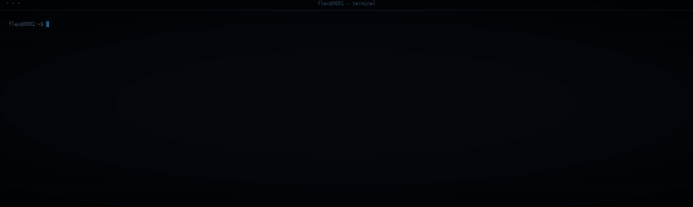
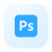
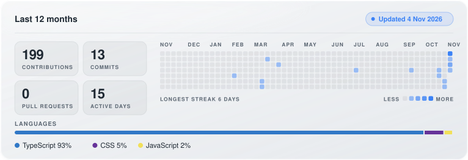

## <picture><source media="(prefers-color-scheme: dark)" srcset="assets/icons/dark/sparkles.svg"></picture> Hi there, I'm FleX0001
### <picture><source media="(prefers-color-scheme: dark)" srcset="assets/icons/dark/code.svg"></picture> Developer
<picture><source media="(prefers-color-scheme: dark)" srcset="assets/icons/dark/terminal.svg"></picture> I develop FiveM resources and web projects. <picture><source media="(prefers-color-scheme: dark)" srcset="assets/icons/dark/gamepad.svg"></picture> I'm also into 3D modeling, graphic design, game development and Discord bots. <picture><source media="(prefers-color-scheme: dark)" srcset="assets/icons/dark/wrench.svg"></picture> Always building, breaking and improving things.

  <a href="https://discord.com/users/852666444306186300"><picture><source media="(prefers-color-scheme: dark)" srcset="assets/icons/dark/discord.svg"></picture></a>

### <picture><source media="(prefers-color-scheme: dark)" srcset="assets/icons/dark/layers.svg"></picture> Languages and Tools

  <picture><source media="(prefers-color-scheme: dark)" srcset="assets/icons/dark/lua.svg"></picture>
  <picture><source media="(prefers-color-scheme: dark)" srcset="assets/icons/dark/typescript.svg"></picture>
  <picture><source media="(prefers-color-scheme: dark)" srcset="assets/icons/dark/javascript.svg"></picture>
  <picture><source media="(prefers-color-scheme: dark)" srcset="assets/icons/dark/python.svg"></picture>
  <picture><source media="(prefers-color-scheme: dark)" srcset="assets/icons/dark/csharp.svg"></picture>
  <picture><source media="(prefers-color-scheme: dark)" srcset="assets/icons/dark/html5.svg"></picture>
  <picture><source media="(prefers-color-scheme: dark)" srcset="assets/icons/dark/css.svg"></picture>

  <picture><source media="(prefers-color-scheme: dark)" srcset="assets/icons/dark/react.svg"></picture>
  <picture><source media="(prefers-color-scheme: dark)" srcset="assets/icons/dark/nextdotjs.svg"></picture>
  <picture><source media="(prefers-color-scheme: dark)" srcset="assets/icons/dark/vite.svg"></picture>
  <picture><source media="(prefers-color-scheme: dark)" srcset="assets/icons/dark/tailwindcss.svg"></picture>
  <picture><source media="(prefers-color-scheme: dark)" srcset="assets/icons/dark/nodedotjs.svg"></picture>
  <picture><source media="(prefers-color-scheme: dark)" srcset="assets/icons/dark/mysql.svg"></picture>
  <picture><source media="(prefers-color-scheme: dark)" srcset="assets/icons/dark/mongodb.svg"></picture>
  <picture><source media="(prefers-color-scheme: dark)" srcset="assets/icons/dark/postgresql.svg"></picture>

  <picture><source media="(prefers-color-scheme: dark)" srcset="assets/icons/dark/fivem.svg"></picture>
  <picture><source media="(prefers-color-scheme: dark)" srcset="assets/icons/dark/unity.svg"></picture>
  <picture><source media="(prefers-color-scheme: dark)" srcset="assets/icons/dark/blender.svg"></picture>
  <picture><source media="(prefers-color-scheme: dark)" srcset="assets/icons/dark/photoshop.svg"></picture>
  <picture><source media="(prefers-color-scheme: dark)" srcset="assets/icons/dark/discordjs.svg"></picture>
  <picture><source media="(prefers-color-scheme: dark)" srcset="assets/icons/dark/git.svg"></picture>
  <picture><source media="(prefers-color-scheme: dark)" srcset="assets/icons/dark/github.svg"></picture>
  <picture><source media="(prefers-color-scheme: dark)" srcset="assets/icons/dark/npm.svg"></picture>
  <picture><source media="(prefers-color-scheme: dark)" srcset="assets/icons/dark/vercel.svg"></picture>
  <picture><source media="(prefers-color-scheme: dark)" srcset="assets/icons/dark/cloudflare.svg"></picture>

### <picture><source media="(prefers-color-scheme: dark)" srcset="assets/icons/dark/activity.svg"></picture> Stats

<picture><source media="(prefers-color-scheme: dark)" srcset="assets/stats-dark.svg"></picture>
